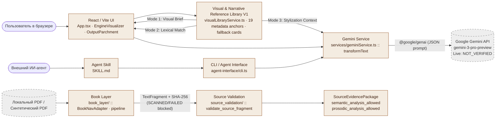

# Архитектура PushkinRhymeEngine 2.0 (`v0.1.0-alpha`, Stage C+)

В этом документе отражена **фактически существующая** архитектура открытого образовательного и творческого поэтического движка **PushkinRhymeEngine 2.0** на момент альфа-релиза `v0.1.0-alpha` (без изображения ещё не реализованных модулей `C1`–`C8`, `M8`, OCR и Образовательного режима как действующих).

---

## 1. Фактическая схема взаимодействия (Mermaid)

> **Примечание по связям:** На этапе `v0.1.0-alpha` браузерный React/Vite-контур и автономный Python-контур (`Book Layer` -> `Source Validation`) не соединены HTTP-мостом (интеграция запланирована после стабилизации аналитики в Этапах D–G).

---

## 2. Реализованные подсистемы (`IMPLEMENTED` / `TESTED`)

### 2.1. React / Vite UI (`App.tsx`, `components/*`, `constants.tsx`, `types.ts`)
- Управляет вводом текста, переключением между «Рифменной машиной» и «Художественной библиотекой» и выводом результата на пергаменте (`OutputParchment.tsx`).
- `EngineVisualizer.tsx` анимирует 6 шагов `EngineStage` (`800ms` на шаг) параллельно вызову `transformText()`. Это визуализация ожидания, а не раздельные анализаторы стиха.

### 2.2. Gemini Service (`services/geminiService.ts`)
- Содержит `transformText(text)` для генерации JSON `{ poem, moral }` через `gemini-3-pro-preview`.
- Ограничения формы задаются системным промптом. Программного парсера метра/рифмы и проверки фактической точности в TypeScript пока нет (`PLANNED`).

### 2.3. Visual & Narrative Reference Library V1 (`services/visualLibraryService.ts`, `components/visual-library/*`, `data/visual-library/*`)
- Содержит структурированный каталог из 19 визуальных якорей и 8 повествовательных паттернов.
- **Режим 1:** синтез текстового брифа открытки.
- **Режим 2:** детерминированный лексический подбор ориентиров по тексту стиха (`matchPoemToAnchors()`).
- **Режим 3:** добавление образного контекста к запросу перед вызовом неизменённой `transformText()`.
- **Публичный релиз и fallback:** локальные AI-PNG временно исключены из публичного Git-релиза (`public/assets/aistudio/README.md`); UI корректно отображает карточки по метаданным в режиме текстового fallback и поддерживает пользовательские якоря в `localStorage`.
- **Граница достоверности:** библиотека изолирована от `Book Layer` и `Source Validation`.

### 2.4. CLI / Agent Interface (`agent-interface/cli.ts`, `SKILL.md`, `skills/pushkin-rhyme-machine/`)
- Предоставляет команды `info`, `help`, `generate` (`--text`, `--input`, `stdin`, `--output`).
- В `info` явно заявлено: `programmatic_meter_validation: false`, `validation_mode: "prompt_guided_llm_generation"`.

### 2.5. Book Layer (`/book_layer`, Python `>=3.10`, `PyMuPDF >= 1.24`)
- Изолированная адаптация `PushkinBookLayer 0.1` без модификации `BOOK-NAV Classic V6`.
- Модели `SourceDocument`, `PageReference`, `BookNode`, `TextFragment` (`book_models.py`).
- `BookNavAdapter` (`book_nav_adapter.py`) различает `TEXT_LAYER`, `SCANNED_PAGE`, `PARTIAL`, `FAILED`, хранит переносимый `pdf_path` и защищает `extract_source_lines()` от сканов и сбоев.
- `pipeline.to_c1_input()` программно блокирует `SCANNED_PAGE`, `FAILED` и пустой текст через `SourceHandoffBlockedError`.

### 2.6. Source Validation (`/source_validation`, `SOURCE_EVIDENCE_PACKAGE_SCHEMA.json`)
- Независимый шлюз качества, выпускающий `SourceEvidencePackage` с полным provenance (`work_id`, `edition_id`, `witness_id`, `page_ref`, `fragment_id`, `source_hash`, `source_class`).
- Разделяет `semantic_analysis_allowed` и `prosodic_analysis_allowed`.

---

## 3. Будущие этапы (`PLANNED`, в коде отсутствуют)

- Модули `C1` (сегментация), `C6a/C6b` (детерминированный просодический анализ), `M8` (аудит происхождения) и `C8` (верифицированная генерация + серверный API-прокси).
- **Образовательный режим (Educational Mode):** структурированное сопоставление исходного утверждения, стихотворения, использованных ритмических и образных приёмов, сохранённых смысловых опор и явного перечня упрощений ради ритма (`POETIC FORM MUST NOT OVERRIDE FACTUAL ACCURACY`).
